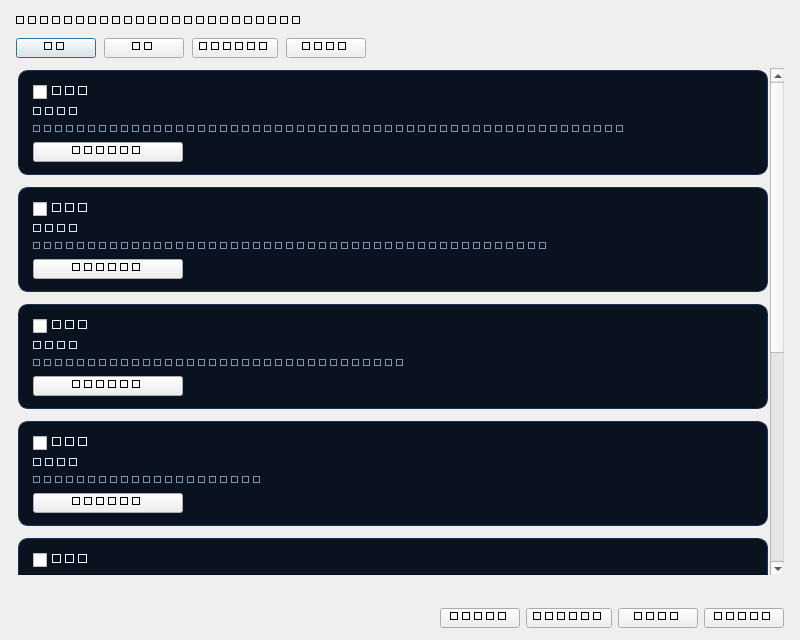

# MultiVoice Summary Suit

<p align="center"></p>

**Turn long audio and video into readable, checkable text assets — locally.**

**English** | [中文](README.zh.md)

A local-first pipeline that goes from media file to four finished deliverables, with a bilingual transcript and subtitles you can verify before trusting the output.

```text
audio/video → audio track → VAD chunks → ASR → term repair → translation
                                          └→ knowledge units → four deliverables
```

---

## What it does

1. **Ingest** — local files or a public URL (yt-dlp).
2. **Transcribe** — Qwen3-ASR on CPU, chunked so long recordings do not blow up memory.
3. **Repair** — a time-aware term library fixes misheard names (`梁盛 → 梁圣`, `张居中 → 张居正`, `周康亨 → Ro Khanna`).
4. **Emit** — four deliverables, each in Chinese and English, plus bilingual text and SRT subtitles.

Everything runs on your machine. No audio leaves the box unless you deliberately point the LLM at a cloud endpoint.

## Outputs

Every job writes to `output/<YYYYMMDD-NN>/`:

| File | What it is |
|---|---|
| `a-script.md` / `.en.md` | **Clean spoken script** — readable first-person draft, fillers removed, facts kept |
| `b-expand.md` / `.en.md` | **Knowledge expansion draft** — third-person rewrite that adds background for non-common-sense points |
| `c-report.md` / `.en.md` | **Knowledge report** — each point explained as what / why / how / limits |
| `d-brief.md` / `.en.md` | **Study brief** — conclusion, key points, short body |
| `text/original.txt` | Corrected transcript |
| `text/translated.<lang>.txt` | Translation |
| `text/bilingual.*.txt` | Side-by-side text for proofreading |
| `text/subtitle.zh.srt` | Chinese subtitles, 13–26 characters per cue |
| `text/subtitle.en.srt` | English subtitles, 13–26 characters per cue |

The `.md` without a suffix is always Chinese; `.en.md` is always English — regardless of the source language.

## Screenshots

<p align="center"></p>

| Term library | Review queue |
|---|---|
|  |  |

## Requirements

- Windows 10/11 (tray app is Win32-focused)
- Python 3.12
- FFmpeg 6+ on `PATH`
- An OpenAI-compatible LLM endpoint (local llama.cpp / Ollama / LM Studio, or a cloud API)
- Qwen3-ASR model directory (≈1.7 GB) for transcription

## Install from source

```powershell
git clone https://github.com/aheechan/MultiVoice-Summary-Suit.git
cd MultiVoice-Summary-Suit

python -m venv .venv
.venv\Scripts\activate
pip install -e .

Copy-Item configs\paths.example.toml  configs\paths.toml
Copy-Item configs\models.example.toml configs\models.toml
```

Edit `configs/paths.toml`:

| Key | Meaning |
|---|---|
| `ffmpeg` | Path to `ffmpeg.exe` |
| `work` | Job cache directory (temporary) |
| `output` | Deliverables directory |
| `asr_model` | Qwen3-ASR model folder |
| `glossary` | Term-library directory |

Edit `configs/models.toml` to point at your LLM:

```toml
[[llm.providers]]
name = "local"
base_url = "http://127.0.0.1:8082/v1"
model = "Qwen3.5-9B"
enabled = true
priority = 1
```

Check everything:

```powershell
python -m multivoice doctor
```

> This repository ships **source only**. There is no bundled installer or portable
> package in Releases — build from source with the steps above.

## Usage

### Tray app

Double-click `Start-MultiVoice.bat`, or drag a media file onto it.

The workflow is two-step on purpose:

1. **Transcribe** — audio → corrected transcript + bilingual text + subtitles.
2. **Pick a deliverable** — clean script / expansion / report / brief, each in ZH and EN.

Tray menu extras: current model provider, pending-term review, cache cleanup, settings.

### Command line

```powershell
mvs run --input "D:\media\sample.mp4" --lang auto
mvs run --input sample.mp4 --stages asr,correct --outputs a
mvs tray --panel

mvs glossary list
mvs glossary pending
mvs glossary add --term 梁圣 --alias 梁盛 --domain ai --definition "..."
mvs discover
mvs cache --stats
mvs cache --clean --days 30
```

## Term library

The library is what makes names survive transcription. Each entry stores `category`, `domain`, `topic`, `definition`, `en`, `sources` and `confidence`. **Entries never expire** — a term is a fact, not a subscription.

Five mechanisms:

1. **Alias repair** — known mishearings are rewritten before the LLM sees the text.
2. **Correction memory** — once `张居中 → 张居正` is confirmed, the wrong spelling never comes back.
3. **Triage** — at job time the model splits candidates into proper nouns (queued) and ordinary phrases (ignored).
4. **Multi-source research** — Wikipedia (zh/en) + Baidu Baike + Bing, one best hit per source, irrelevant hits dropped.
5. **Human review** — pending terms show a video timecode and source file; double-click a term to correct it, or write it into the library.

Editing a term also rewrites the current job's export folder, so the documents and subtitles stay consistent.

## Models and hardware

| Component | Suggested | Notes |
|---|---|---|
| ASR | Qwen3-ASR 0.6B | CPU works; ~1.7 GB on disk |
| LLM | Qwen3.5-9B Q6_K via llama.cpp | ~7.7 GB; needs ~10 GB VRAM at 4k context |
| Anything smaller | 1.7B–4B | Faster, but expect more rewriting drift |

Provider order is editable in the app (add / edit / reorder / test). If the first provider fails, the next one is tried automatically.

## Privacy

- Audio, transcripts and deliverables stay local.
- Web lookups send only the term being researched, never the transcript.
- Cloud LLM providers are opt-in and configured by you.

## Limitations

- Subtitle timecodes are estimated from ASR segment spans and character offsets, not word-level alignment — expect a few seconds of drift.
- Baidu Baike and Google may be unreachable depending on your network; the pipeline simply skips a source it cannot use.
- The expansion draft deliberately caps growth (2.6× target, 3× hard limit) to keep it from turning into fabrication.
- Windows-only tray integration; the CLI is cross-platform in principle but untested elsewhere.

## License

GPL-3.0 — see [LICENSE](LICENSE). This project bundles a GPL build of FFmpeg in its
portable package, so the GNU GPL is the compatible choice.

## Links

- Issues: https://github.com/aheechan/MultiVoice-Summary-Suit/issues
- Changelog: see commit history

## Support

If this project saved you some time, you can [buy me a coffee](https://ko-fi.com/ahee52).
