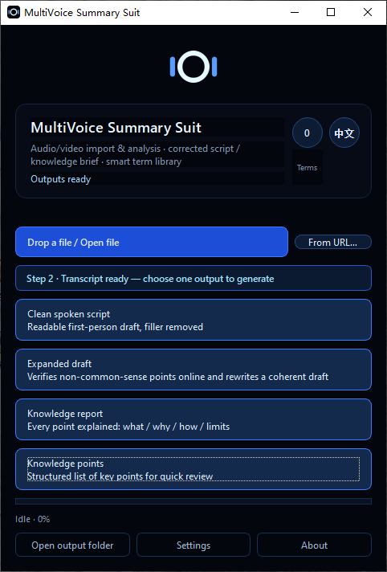
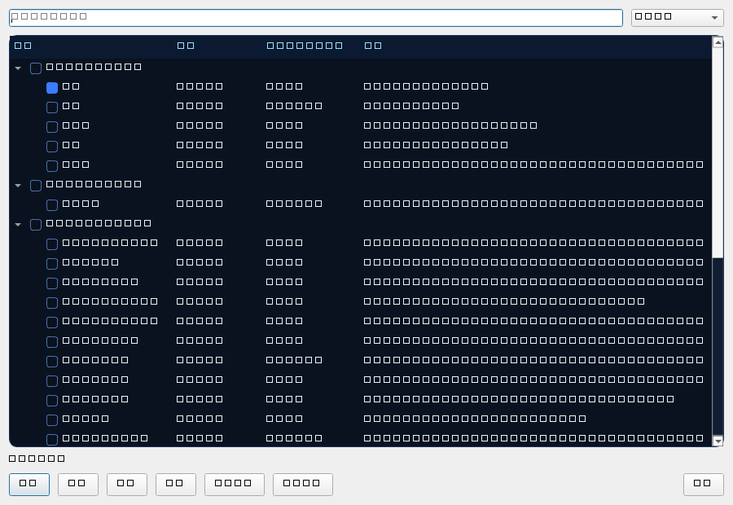
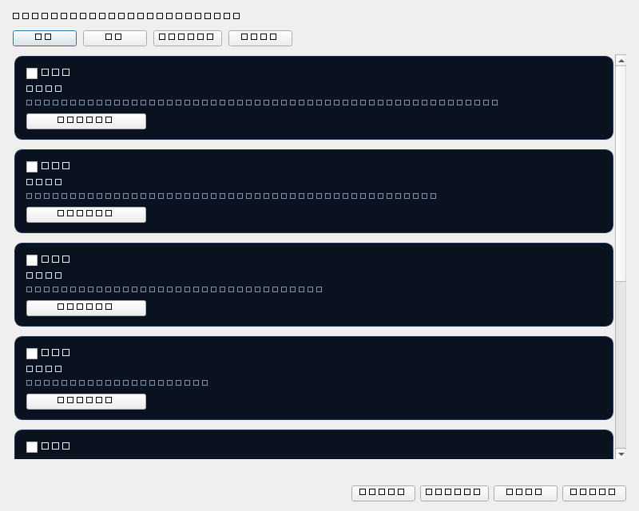

# MultiVoice Summary Suit

<p align="center"></p>

**把长篇音视频变成可读、可核对的文字资产，全程本地。**

**中文** | [English](README.md)

一条本地优先的流水线：从媒体文件出发，产出四份成品，并在你信任它们之前先给出可核对的双语原文与字幕。

```text
音视频 → 抽音轨 → VAD 切片 → ASR → 词条修复 → 翻译
                                    └→ 知识单元 → 四份成品
```

---

## 它做什么

1. **导入** —— 本地文件，或公开可下载的链接（yt-dlp）。
2. **转写** —— Qwen3-ASR，CPU 可跑，长音频按段切分，不会撑爆内存。
3. **修复** —— 带时效意识但不设过期的词条库，修正听错的人名地名（`梁盛 → 梁圣`、`张居中 → 张居正`、`周康亨 → Ro Khanna`）。
4. **产出** —— 四份成品，每份都有中英两版；另附双语文本与 SRT 字幕。

除了你主动把 LLM 指向云端，音频不会离开本机。

## 输出

每个任务写到 `output/<YYYYMMDD-NN>/`：

| 文件 | 内容 |
|---|---|
| `a-script.md` / `.en.md` | **干净口播稿** —— 可直接朗读的第一人称稿，去口癖，保留全部事实 |
| `b-expand.md` / `.en.md` | **知识拓展稿** —— 第三人称重写，为非常识内容补充背景 |
| `c-report.md` / `.en.md` | **知识点报告** —— 逐点讲解：是什么 / 为什么 / 怎么做 / 边界 |
| `d-brief.md` / `.en.md` | **知识点梳理** —— 一句话结论 + 要点 + 短正文 |
| `text/original.txt` | 校正后的原文 |
| `text/translated.<lang>.txt` | 译文 |
| `text/bilingual.*.txt` | 中英对照，便于校对 |
| `text/subtitle.zh.srt` | 中文字幕，每行 13–26 字符 |
| `text/subtitle.en.srt` | 英文字幕，每行 13–26 字符 |

不带后缀的 `.md` 永远是中文，`.en.md` 永远是英文——与源语言无关。

## 界面

<p align="center"></p>

| 词条管理 | 待审队列 |
|---|---|
|  |  |

## 环境要求

- Windows 10/11（托盘程序面向 Win32）
- Python 3.12
- FFmpeg 6+（在 `PATH` 中）
- 一个 OpenAI 兼容的 LLM 端点（本地 llama.cpp / Ollama / LM Studio，或云端 API）
- Qwen3-ASR 模型目录（约 1.7 GB）

## 从源码安装

```powershell
git clone https://github.com/aheechan/MultiVoice-Summary-Suit.git
cd MultiVoice-Summary-Suit

python -m venv .venv
.venv\Scripts\activate
pip install -e .

Copy-Item configs\paths.example.toml  configs\paths.toml
Copy-Item configs\models.example.toml configs\models.toml
```

`configs/paths.toml` 关键项：

| 键 | 含义 |
|---|---|
| `ffmpeg` | `ffmpeg.exe` 路径 |
| `work` | 任务缓存目录（临时） |
| `output` | 成品目录 |
| `asr_model` | Qwen3-ASR 模型目录 |
| `glossary` | 词条库目录 |

`configs/models.toml` 指向你的模型：

```toml
[[llm.providers]]
name = "local"
base_url = "http://127.0.0.1:8082/v1"
model = "Qwen3.5-9B"
enabled = true
priority = 1
```

自检：

```powershell
python -m multivoice doctor
```

> 本仓库**只提供源码**，不包含整合包或便携版；请按上面的步骤从源码运行。

## 使用

### 托盘程序

双击 `Start-MultiVoice.bat`，或把媒体文件直接拖到 bat 上。

流程刻意分成两段：

1. **转写** —— 音频 → 校正原文 + 双语文本 + 字幕。
2. **选成品** —— 干净口播稿 / 知识拓展稿 / 知识点报告 / 知识点梳理，各自中英两版。

托盘菜单还有：当前模型来源、待审词条、缓存清理、设置。

### 命令行

```powershell
mvs run --input "D:\media\sample.mp4" --lang auto
mvs run --input sample.mp4 --stages asr,correct --outputs a
mvs tray --panel

mvs glossary list
mvs glossary pending
mvs glossary add --term 梁圣 --alias 梁盛 --domain ai --definition "..."
mvs discover
mvs cache --stats
mvs cache --clean --days 30
```

## 词条库

词条库决定了人名能不能在转写中活下来。每条记录 `category`、`domain`、`topic`、`definition`、`en`、`sources`、`confidence`。**词条永不过期**——词条是事实，不是订阅。

五个机制：

1. **别名修复** —— 已知听错写法在送进模型前就被替换。
2. **纠正记忆** —— 一旦确认 `张居中 → 张居正`，错误写法不会再出现。
3. **任务时筛选** —— 模型把候选词分成专有名词（入队）与普通词组（忽略）。
4. **多源取证** —— 维基（中/英）+ 百度百科 + Bing，每个来源只留一条最匹配，不相关的丢弃。
5. **人工复审** —— 待审词条显示视频时间码与来源文件；双击词条即可纠正，或写入词库。

修词条会同步改写当前任务的输出目录，文档与字幕保持一致。

## 模型与硬件

| 组件 | 建议 | 说明 |
|---|---|---|
| ASR | Qwen3-ASR 0.6B | CPU 可跑，磁盘约 1.7 GB |
| LLM | Qwen3.5-9B Q6_K（llama.cpp） | 约 7.7 GB；4k 上下文约需 10 GB 显存 |
| 更小的模型 | 1.7B–4B | 更快，但改写漂移更明显 |

模型来源顺序可在界面里增删、排序、测速；第一个失败会自动尝试下一个。

## 隐私

- 音频、转写、成品全部留在本机。
- 联网检索只发送被查的词条，不发送转写全文。
- 云端 LLM 需要你主动配置。

## 已知限制

- 字幕时间码由 ASR 分段与字符偏移估算，不是词级对齐，可能有几秒误差。
- 百度百科、Google 是否可达取决于网络；连不上时流水线会直接跳过该来源。
- 拓展稿有明确篇幅上限（目标 2.6 倍，硬上限 3 倍），避免扩写成编造。
- 托盘集成仅 Windows；命令行原则上跨平台但未测试。

## 许可

GPL-3.0，详见 [LICENSE](LICENSE)。便携包内置的是 GPL 版 FFmpeg，所以选用 GNU GPL 以保持一致。

## 链接

- 问题反馈：https://github.com/aheechan/MultiVoice-Summary-Suit/issues
- 变更记录：见提交历史

## 支持

如果这个项目帮你省下了时间，可以[请我喝杯咖啡](https://ko-fi.com/ahee52)。
